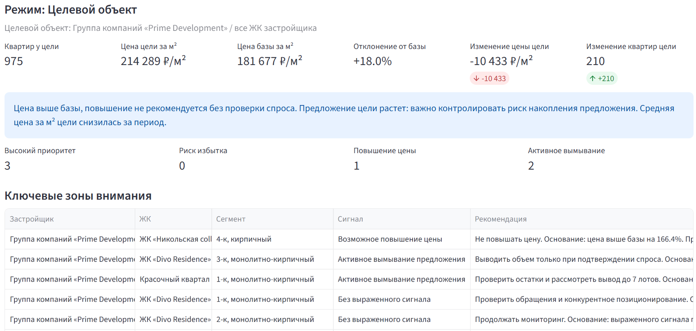
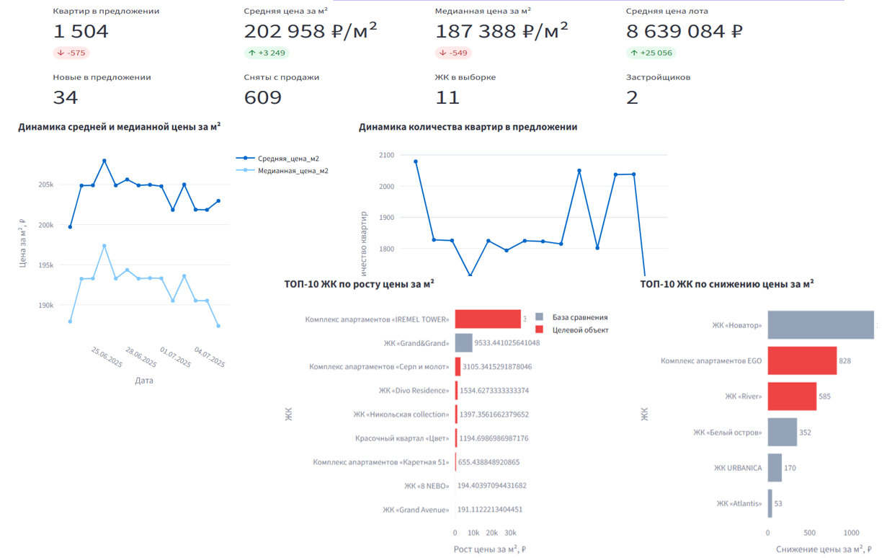
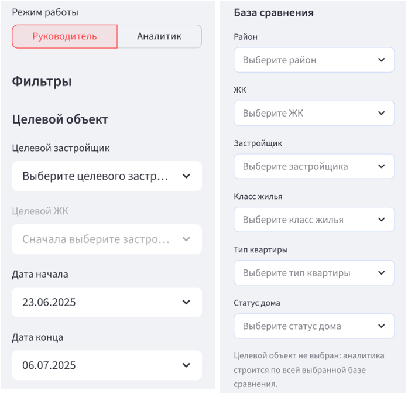
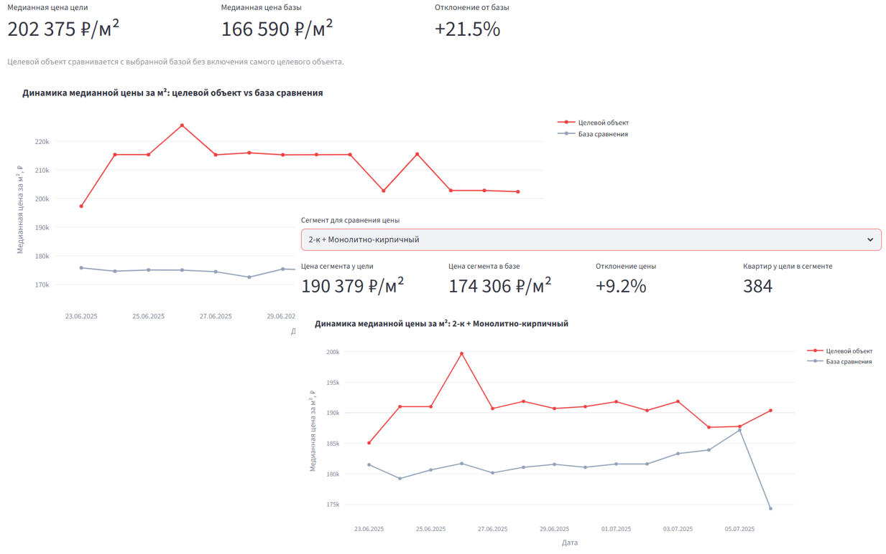
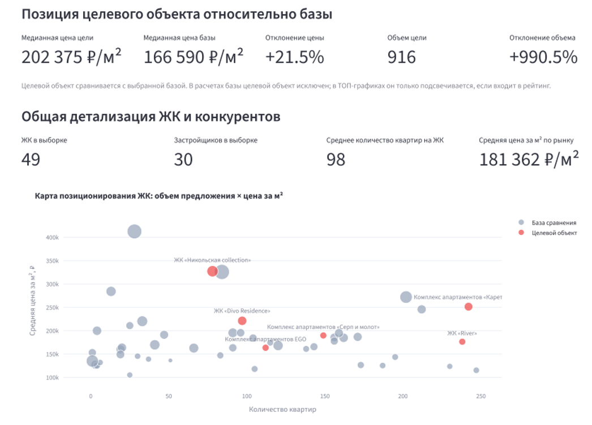
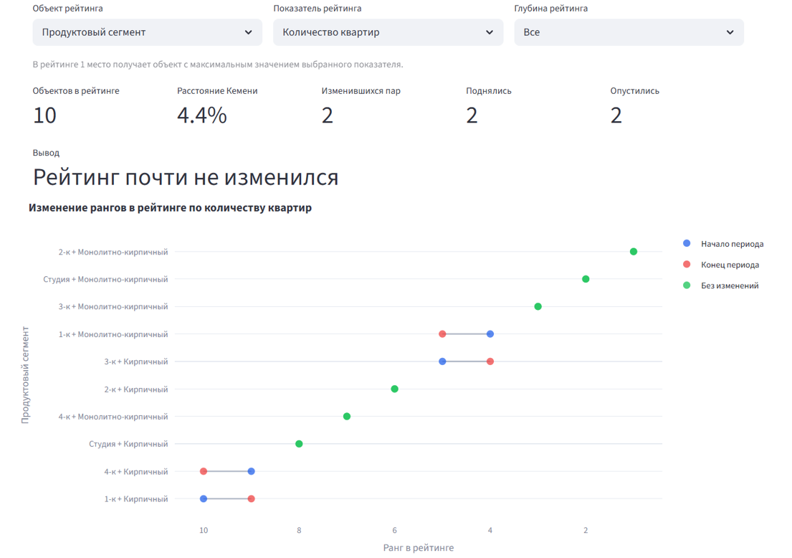
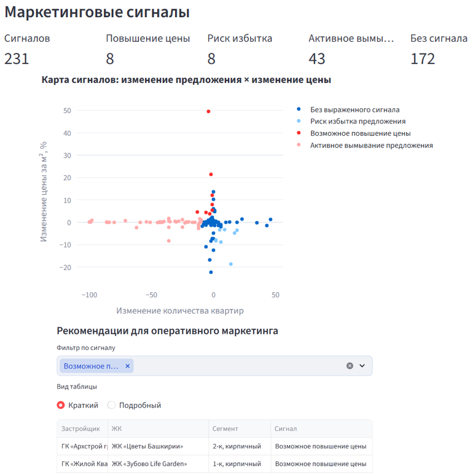
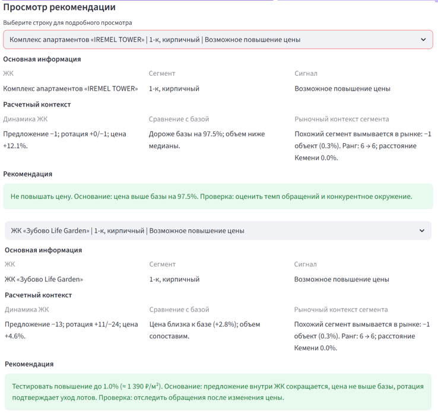
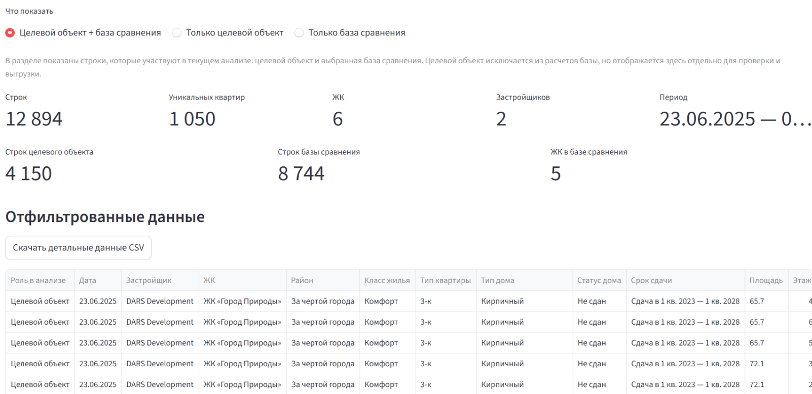

# Обзор проекта: приложение для анализа рынка первичной жилой недвижимости

>  Документ описывает фактически реализованные возможности Python/Streamlit-приложения и иллюстрируется скриншотами из ВКР. Код и исходные рыночные данные не публикуются.

## 1. Цель и бизнес-контекст

Проект автоматизирует подготовку снимков предложения новостроек, расчёт KPI, анализ цен, структуры и ротации предложения, сравнение конкурентов и формирование маркетинговых сигналов. Предметная область – первичная жилая недвижимость; интерфейс исходного приложения обозначен как «Оперативный маркетинг новостроек Уфы».

**Пользователи:** аналитик коммерческого отдела (детальное исследование) и руководитель коммерческого отдела (сводная картина для решений). Система не подтверждает фактические продажи: исчезновение объявления может иметь и другие причины.

## 2. Технологии и обработка данных

**Python · Pandas · NumPy · Streamlit · Plotly.** Приложение читает CSV, преобразует даты и числовые значения, заполняет отсутствующие текстовые значения, извлекает тип дома, восстанавливает район по ЖК там, где это возможно, формирует идентификатор квартиры и удаляет дублирующиеся записи. После подготовки формируется аналитическая выборка.

**Базовые KPI:** число уникальных квартир, жилых комплексов, застройщиков и районов; средняя и медианная цена за м²; средняя стоимость и площадь квартиры. Сравнения выполняются по доступным датам наблюдения.

## 3. Режимы работы и доступные разделы

### Руководитель

По умолчанию открывается режим **«Руководитель»**. Доступны два раздела:

- **Управленческий обзор:** компактное представление ключевых изменений рынка для оценки ситуации и выбора направлений дальнейшего анализа.
- **Обзор рынка:** сокращённая версия рыночной аналитики для быстрого просмотра сводных показателей.

### Аналитик

Режим **«Аналитик»** предоставляет девять разделов: **Обзор рынка, Цены, Предложение, ЖК и конкуренты, Сравнение рейтингов, Районы, Ассортимент, Рекомендации, Детальные данные**. Он предназначен для проверки исходных показателей, детального сравнения сегментов и изучения причин изменений.

## 4. Фильтры и сценарий анализа

Параметры расположены в боковой панели. Пользователь выбирает **режим работы**, **целевого застройщика** и при необходимости **целевой ЖК**; затем задаёт **дату начала** и **дату конца** и формирует **базу сравнения**.

Для базы сравнения доступны мультивыборы: **район, ЖК, застройщик, класс жилья, тип квартиры и статус дома**. Пустой мультивыбор не ограничивает соответствующий признак. Приложение предупреждает о пустой базе сравнения, отсутствии данных целевого объекта и некорректном диапазоне дат.

**Три сценария:**

1. **Целевой застройщик не выбран:** анализируется вся отфильтрованная база сравнения.
2. **Выбран застройщик, но не ЖК:** целью становятся все ЖК застройщика; в базу сравнения не включаются его объекты.
3. **Выбран конкретный ЖК:** целью становится выбранный комплекс; он исключается из базы сравнения.

Целевой объект и база сравнения различаются в аналитических представлениях. Это позволяет исследовать как рынок в целом, так и позицию конкретного участника.

## 5. Аналитические разделы и визуализации

### 5.1 Обзор рынка

Сводит ключевые рыночные KPI и изменения между датами наблюдения. Позволяет оценивать общий масштаб предложения, ценовые характеристики и динамику показателей. В режиме руководителя доступен сокращённый вариант.

### 5.2 Цены

Анализирует среднюю и медианную цену за м², стоимость квартир и ценовую динамику. Графики и таблицы помогают сопоставлять временные периоды и выбранные сегменты, а в целевом сценарии – объект с конкурентной базой.

### 5.3 Предложение

Исследует количество доступных квартир и изменение состава предложения. Сопоставление идентификаторов между снимками позволяет выделять появившиеся, исчезнувшие и сохранившиеся объекты; также рассчитывается ротация предложения по группам. Исчезнувшая публикация не равнозначна подтверждённой продаже.

### 5.4 ЖК и конкуренты

Сравнивает целевой объект и конкурентную базу по ценовым и количественным характеристикам. Используется для оценки относительного положения ЖК или застройщика.

### 5.5 Сравнение рейтингов

Сопоставляет порядок объектов в рейтингах между периодами. В приложении реализован расчёт **расстояния Кемени** по общим элементам двух ранжированных списков: показатель отражает изменение относительного порядка объектов, а не изменение абсолютных цен. Предусмотрена интерпретация степени перестройки рейтинга.

### 5.6 Районы

Представляет территориальный срез рынка: сопоставление районов по структуре предложения и ценовым показателям. Помогает выявлять различия между локациями.

### 5.7 Ассортимент

Исследует состав предложения по характеристикам квартир и его изменение между датами. Позволяет анализировать ассортимент целевого объекта относительно базы сравнения.

### 5.8 Рекомендации

Раздел преобразует рассчитанные показатели в **маркетинговые сигналы и текстовые интерпретации**. Среди предусмотренных сигналов: «Возможное повышение цены», «Риск избытка предложения», «Активное вымывание предложения» и «Без выраженного сигнала». Интерпретации носят рекомендательный характер и требуют проверки бизнес-контекста.

В интерфейсе присутствуют дополнительные элементы выбора сигналов и представления результатов.

### 5.9 Детальные данные

Предоставляет табличный просмотр данных с переключением режима отображения и выгрузкой CSV для последующей проверки и анализа. Это помогает проследить связь агрегированных KPI с исходными наблюдениями.

## 6. Как читать графики и показатели

- **Временные графики** показывают изменение показателей между датами снимков; при интерпретации важно учитывать состав выборки.
- **Сравнительные диаграммы** помогают обнаружить отличия целевого объекта от выбранной конкурентной базы; результат зависит от фильтров.
- **Рейтинги** отражают относительное положение объектов, а расстояние Кемени – изменение порядка сопоставимых участников.
- **Таблицы** дают детализацию и возможность проверки показателей; агрегаты не заменяют анализ отдельных наблюдений.
- **Сигналы** являются правилами аналитической интерпретации, а не автоматическим доказательством спроса, продаж или причин рыночных изменений.

## 7. Результаты и ограничения

Реализован единый интерфейс, связывающий очистку рыночных данных, KPI, сравнение периодов и объектов, визуализацию и рекомендации. Кейс демонстрирует навыки **обработки и анализа данных, расчёта KPI, создания дашбордов и интерпретации результатов анализа для решения бизнес-задач**.

Репозиторий содержит только документацию и иллюстрации. **Исходный код, датасет и работающий демосервис отсутствуют.** Скриншоты взяты из раздела программной реализации ВКР; они отражают состояние приложения на момент подготовки работы.
